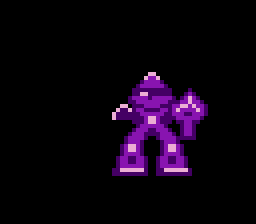
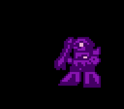
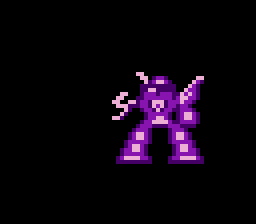

# MOJAxMOJA WARS (ファミコン向け 縦スクロール＆横画面ロボット戦シューティング)

ファミリーコンピュータ (NES) 向けの 1人プレイ専用シューティングゲームです。  
**縦スクロールの宇宙戦 → 味方支援機との合体 → 横画面でのロボット（モビルスーツ）1対1ボス戦** という流れで、全4宙域を突破します。  
6502 アセンブラ (`cc65` / `ca65` + `ld65`) を用いてフルスクラッチで実装しています。

> 細かい挙動・数値・内部仕様は **[docs/SPEC.md（詳細仕様書）](docs/SPEC.md)** にまとめています。

## ▶ プレイ方法 (Webエミュレータ)

**[cluade-famicom-emu (Web版)](https://mitsutaka-kusakabe.github.io/cluade-famicom-emu/)** を開き、画面左上の **「ROMを開く」** から `game.nes` (または `roms/v1.0.0-mojaxmoja-wars.nes`) を選択するとブラウザ上で直接プレイできます。

## スクリーンショット

| タイトル | STAGE 1 道中（第3形態のレーザー照射） |
| :---: | :---: |
|  |  |

| STAGE 1 味方支援機による合体 | WARNING（ボス接近） |
| :---: | :---: |
|  |  |

**ボス戦（横画面）**


| 狂乱モード：上段の構え | 狂乱モード：振り下ろし |
| :---: | :---: |
|  |  |


## ストーリー

地球が謎の地球外生命体 **「MOJAxMOJA」** の侵略を受けている。  
地球防衛軍は最新鋭コアブロック戦闘機 **「KBX-026 SAMURAI」** を宇宙へ送り出し、これを迎撃する。  
ステージ途中で駆けつける味方支援輸送機から「脚部パーツ」「胸部パーツ」を受け取って合体し、**ガンダム型モビルスーツ**へと変形。各宙域に立ちはだかる量産型ロボットと、宿敵・**赤いモビルスーツ**を撃破して地球を救え！

## ゲームの流れ

```text
 タイトル → ブリーフィング → ┌ 縦スクロール道中（前半） ┐
                              │  ・MOJAxMOJA 編隊を迎撃  │
                              │  ・中ボス直前に合体！    │
                              └─────────┬───────────────┘
                                        ▼
                      WARNING → 横画面ボス戦：量産型ロボット（中ボス）
                                        ▼
                          縦スクロール道中（後半）… ラスボス直前にも再合体
                                        ▼
                      WARNING → 横画面ボス戦：宿敵・赤いMS
                                        ▼
                 ハイパーワープ → 次の宙域へ（STAGE 4 撃破でエンディング）
```

| ステージ | 宙域 | 中ボス（量産型ロボット） | ステージボス |
| :---: | :--- | :--- | :--- |
| **STAGE 1** | **月 (THE MOON)** | ザク型 `MOJA-01`（HP 30） | 宿敵・赤いMS（HP 80） |
| **STAGE 2** | **火星 (RED MARS)** | ドム型 `MOJA-02`（HP 35） | 宿敵・赤いMS（HP 90） |
| **STAGE 3** | **木星 (JUPITER)** | ズゴック型 `MOJA-03`（HP 40） | 宿敵・赤いMS（HP 100） |
| **STAGE 4** | **地球付近 (EARTH ORBIT)** | グフ型 `MOJA-04`（HP 50） | 宿敵・赤いMS 最終決戦（HP 120・メガ粒子ビーム） |

## 自機：KBX-026 SAMURAI（4形態ドッキング合体システム）

ステージ中、味方支援輸送機が **脚部パーツ** と **胸部パーツ** を運んできます（**各ボス戦の直前** に連続して登場）。パーツを受け取る（接触する）と合体音とともに機体が進化します。  
被弾してもすぐには撃墜されず、**装甲（合体パーツ）がパージされて一段階ダウン** します（初期形態で被弾すると1機ミス。自機は3機）。

| 形態 | 見た目 | 合体条件 | Aボタン主兵装 |
| :---: | :---: | :--- | :--- |
| **第1形態**<br>コアファイター |  | 出撃時 / 被弾パージ後 | **通常ミサイル**（単発・連射可） |
| **第2形態**<br>コア＋脚部 |  | 第1形態 ＋ 脚部パーツ | **3WAY ミサイル**（前方＋左右斜め） |
| **第2.5形態**<br>コア＋胸部 |  | 第1形態 ＋ 胸部パーツ | **2WAY ミサイル**（左右2連装） |
| **第3形態**<br>ガンダム（MS） |  | 脚部 ＋ 胸部（フル合体） | **貫通レーザー**（照射0.3秒／クールタイム0.7秒）＋ **ビームサーベル** |

- **被弾時の変化**：第3形態 → 第2形態 → 第1形態 → 撃墜（1機ミス）。パージ直後は1秒間の無敵。
- **B ボタン：プラズマショックウェーブ**（全形態共通・範囲攻撃）  
  自機周囲に電撃リングが広がり、**画面内の敵弾をすべて消去**しつつ範囲内の敵・ボスにダメージ。約2秒のクールタイム制（画面右下のバッジ `B` で状態確認）。
- **第3形態のビームサーベル（横画面ボス戦のみ）**  
  ボスが近づくと自動的に斬撃が発動し、敵弾を斬り払います。ボスが **狂乱モード** に入ると、**A ボタンを離している間は上段の構え、押している間は振り下ろし** になります（後述）。

### 合体パーツ・味方支援機

| 名称 | 見た目 | 役割 |
| :--- | :---: | :--- |
| **味方支援輸送機** |  | 画面上から自機に寄り添って降下し、パーツを投下して帰還する |
| **脚部パーツ** |  | 取得で第2形態へ（ドッキングボーナス +500点） |
| **胸部パーツ** |  | 取得で第2.5形態へ。脚部と揃えば第3形態へ |

## 敵キャラクタ紹介

### 縦スクロール道中の雑魚：MOJAxMOJA

| 名称 | 見た目 | 動き・攻撃 | 耐久 |
| :--- | :---: | :--- | :---: |
| **MOJA SCOUT**<br>小型偵察機 |  | ゆっくり直進降下し、途中で自機狙い弾を1発撃つ | 1 |
| **MOJA SWOOP**<br>サイン波機動機 |  | 左右に揺れながら降下し、自機狙い弾を撃つ | 1 |
| **MOJA CHARGER**<br>突撃機 |  | 自機Xへホーミングしながら急降下（体当たり） | 1 |
| **MOJA TURRET**<br>重装砲台 |  | ゆっくり降下しつつ低頻度で弾を撃つ高耐久型 | 3〜6<br>(面で増加) |

撃破すると **+100点**。3機編隊で出現し、画面内の敵数・敵弾数はステージが進むほど増えます。

### 横画面ボス：量産型ロボット（中ボス）

| 名称 | 見た目 | 登場 | 特徴 |
| :--- | :---: | :---: | :--- |
| **ザク型 MOJA-01** |  | STAGE 1 | 基本パターン（3WAY弾＋自機狙い弾） |
| **ドム型 MOJA-02** |  | STAGE 2 | 前後ステップ機動が加わる |
| **ズゴック型 MOJA-03** |  | STAGE 3 | 護衛突撃機を射出する |
| **グフ型 MOJA-04** |  | STAGE 4 | 5WAY弾＋ヒートロッド |

### 宿敵：赤いモビルスーツ（各ステージのボス）

| 名称 | 見た目 | 特徴 |
| :--- | :---: | :--- |
| **RIVAL RED MS**<br>宿敵・赤いMS |  | 全ステージのラストに登場。STAGE 3 以降はファンネル（ビット）2基を展開。**STAGE 4 では「即死のメガ粒子ビーム」を約4秒ごとに照射**（予兆のチャージ光球あり／直撃で即死） |

### ボスの狂乱モード（HP 2/5 以下）

ボスは **HPが 2/5 以下** になると武器を構えて突進してくる **狂乱モード** に入ります。

1. **突進** … 自機めがけて猛スピードで接近
2. **追い詰め（0.5秒）** … 自機の目前に張り付いてサーベルを振る
3. **後退（いったん引く）** … 回避の隙を与える
4. **仕切り直し（約0.33秒）** … 反撃のチャンス → 再び突進

ボスは **上段の構え（約0.5秒）⇄ 振り下ろし（0.5秒）** を繰り返します。自機（第3形態）も **A ボタンのリリース＝上段 / 押下中＝振り下ろし** で斬り合います。

## 操作方法

| ボタン | タイトル画面 | プレイ中 | ゲームオーバー / エンディング |
| :--- | :--- | :--- | :--- |
| **十字キー ↑ / ↓** | メニュー選択（`START MISSION` / `STAGE SELECT` / `BOSS BATTLE`） | 自機の8方向移動 | ― |
| **十字キー ← / →** | ステージまたはボスの選択 | 自機の8方向移動 | ― |
| **A ボタン** | ゲーム開始 | 主兵装（ミサイル／レーザー）。狂乱ボス戦の第3形態では上段⇄振り下ろし | タイトルへ戻る |
| **B ボタン** | ステージ／ボス選択を進める | 範囲攻撃（プラズマショックウェーブ） | ― |
| **START** | ゲーム開始 | ポーズ ON / OFF | タイトルへ戻る |
| **SELECT** | メニュー項目の切り替え | ボス戦中：**通常 ⇄ 狂乱モード** を即時切替（テスト用） | ― |

## テスト・デバッグ機能

- **BOSS BATTLE モード**：タイトルで `BOSS BATTLE` を選び、← → で対戦ボス（`1-ZAKU` `2-DOM` `3-ZGOK` `4-GOUF` `R-RED`）を選んで START。  
  道中を飛ばして **第3形態・残機5** でボス戦に直行できます。ボスを倒すとタイトルへ戻ります。
- **SELECT**（ボス戦中）：ボスを即座に狂乱モード（HP 12）へ切り替え／通常戦闘へ復帰。サーベル戦のテストに便利です。

## サウンド

APU 4チャンネル（矩形波×2、三角波、ノイズ）＋ DPCM ドラムで、タイトル・道中（2曲）・ボス戦・ステージクリア・ゲームオーバー（「Rest in Peace」風アレンジ）の BGM を実装。ミサイル、レーザー、プラズマ、ヒット、爆発、ドッキング合体音（「ガッ・シャン！！」）、ワープなどの効果音を搭載しています。

## 必要環境・ビルド方法

ビルドには [cc65](https://cc65.github.io/) ツールチェーン（`ca65` / `ld65`）、`python3`、および `make` を使用します（Windows 環境では WSL 上でのビルドに対応しています）。

```sh
# Ubuntu / WSL の場合
sudo apt install cc65 make python3
```

```sh
python3 tools/gen_chr.py        # CHR-ROM タイルデータ (assets/chr.s) を生成
make                            # game.nes を生成 (iNES 形式, Mapper 0 / NROM-256: PRG 32KB + CHR 8KB)
python3 tools/verify_game.py    # 6502 エミュレータによる全4面通し自動検証テスト
python3 tools/test_boss_mode.py     # ボス戦専用モード & SELECT切替の検証
python3 tools/test_saber_stances.py # サーベル 上段/振り下ろしの検証
python3 tools/render_readme_shots.py # README 用スクリーンショットを docs/images/ に再生成
make clean                      # ビルド成果物を削除
```

生成された `game.nes` を任意の NES エミュレータ（[cluade-famicom-emu](https://mitsutaka-kusakabe.github.io/cluade-famicom-emu/), Mesen, FCEUX 等）で読み込んでプレイできます。

## ディレクトリ構成

```text
├── Makefile              # ca65 / ld65 ビルド定義
├── nes.cfg               # ld65 リンカ設定 (PRG 32KB + CHR 8KB)
├── game.nes              # ビルド済み最新 ROM イメージ
├── roms/                 # バージョン別 ROM アーカイブ (v1.0.0-mojaxmoja-wars.nes)
├── docs/
│   ├── SPEC.md           # 詳細仕様書（挙動・数値・内部仕様）
│   ├── images/           # README / 仕様書用スクリーンショット・キャラクタ画像
│   └── editor/           # Web ステージマップエディタ (index.html / editor.js / style.css)
├── src/
│   ├── main.s            # エントリ・RAM定義・メインループ・NMI ハンドラ
│   ├── header.s          # iNES ヘッダ (Mapper 0 / NROM-256, 水平ミラーリング)
│   ├── ppu.s             # PPU 初期化・ステージ別パレット管理
│   ├── controller.s      # コントローラ入力・エッジ検出・16bit LFSR 乱数
│   ├── scroll.s          # 縦スクロール制御・背景地形ストリーミング描画
│   ├── player.s          # 自機4形態・ミサイル/レーザー/サーベル・B範囲攻撃
│   ├── enemy.s           # 敵編隊スポーン・味方支援機・合体判定・被弾処理
│   ├── boss.s            # 中ボス/赤いMS の AI・狂乱モード・メガ粒子ビーム・撃破演出
│   ├── state.s           # タイトル・ブリーフィング・ワープ・エンディング・ボス戦モード・OAM描画
│   └── sound.s           # APU サウンドエンジン (BGM シーケンサ & SFX)
├── docs/
│   ├── SPEC.md               # 内部技術仕様書 (メモリマップ、APU、数式)
│   ├── editor/               # Web ステージエディタ (index.html / manual.html / editor.js)
│   └── audio-editor/         # Web 楽曲エディタ (index.html / manual.html / audio-editor.js)
├── assets/
│   ├── chr.s             # CHR-ROM タイルパターンデータ (tools/gen_chr.py により生成)
│   ├── stages.s          # 全4ステージマップデータ (LVLMAP01 互換)
│   ├── drums.s           # DPCM ドラムサンプルデータ
│   └── music_*.s         # BGM シーケンスデータ (stage / boss / title / gameover)
└── tools/
    ├── gen_chr.py            # スプライト・背景・フォント CHR-ROM 生成スクリプト
    ├── gen_music.py          # BGM データ生成スクリプト
    ├── verify_game.py        # 6502/PPU 全4面通し自動検証テストスイート
    ├── test_boss_mode.py     # ボス戦専用モード検証
    ├── test_saber_stances.py # サーベル構え検証
    ├── render_screens.py     # PPU スクリーンショット出力スクリプト
    ├── render_readme_shots.py # README 用の高解像度スクリーンショット生成
    └── font.s                # ASCII フォント元データ
```

## Web 開発支援ツール

ブラウザ上で動作する2つの公式Webツールを提供しています。

1. **[Web 楽曲エディタ (`docs/audio-editor/index.html`)](docs/audio-editor/index.html)** ｜ **[📖 楽曲エディタ説明書](docs/audio-editor/manual.html)**
   - ファミコン 2A03 APU (Pulse 1, Pulse 2, Triangle, DMCドラム) のリアルタイム Web Audio 合成エディタ。
   - ピアノロール＆16ステップドラムグリッドによる直感的な作曲。
   - `ca65` アセンブラ用 `.byte` 出力/読込、および `.nesbgm.json` プロジェクト保存対応。
   - 組み込みプリセット（Stage 1, Boss, Title, Game Over）の試聴・編集が可能。

2. **[Web ステージエディタ (`docs/editor/index.html`)](docs/editor/index.html)** ｜ **[📖 ステージエディタ取扱説明書](docs/editor/manual.html)**
   - 全4面のメタ行地形デザインおよび 3機編隊スポナー間隔、敵弾速度、ボス狂乱突進HP閾値のカスタマイズ。
   - **BGM同期プレビュー**: `nes-audio-player.js` と連携し、BGMを再生しながら自機がスクロールして敵・イベントの到達タイミングを視覚的にプレビュー（中ボス・大ボスの自動曲切り替え対応）。
   - **💾 拡張設定入り .nes の書き出し**: 編集した設定をそのまま埋め込んだ `.nes` ROM のワンクリック書き出し。
   - **📤 ca65 ASM 出力**: 編集したマップおよびパラメータを `assets/stages.s` 用の ca65 アセンブラソースとして出力し、プロジェクトの標準仕様へ恒久適用可能。
   - **↺ 標準配置に戻す**: いつでも実機ROM本来のデフォルト地形にワンクリック復元。

## ライセンス

MIT
