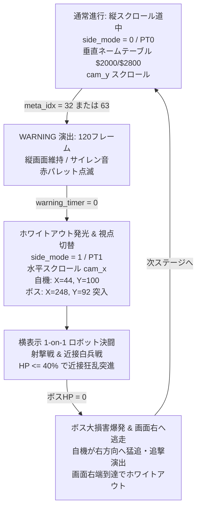
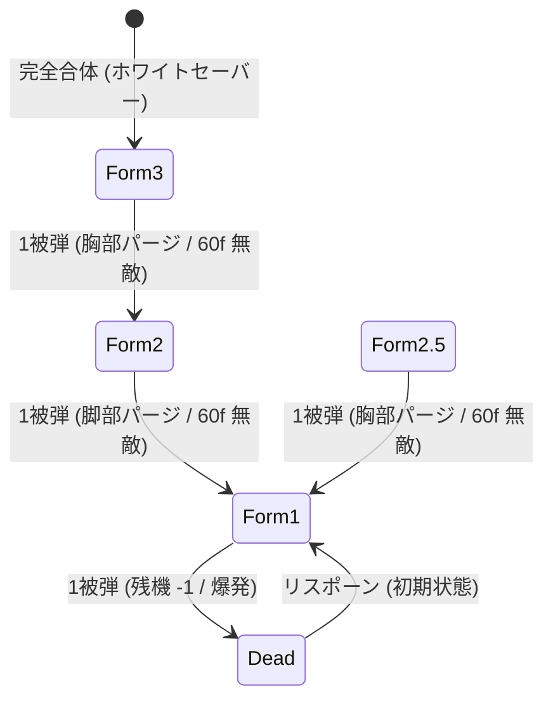
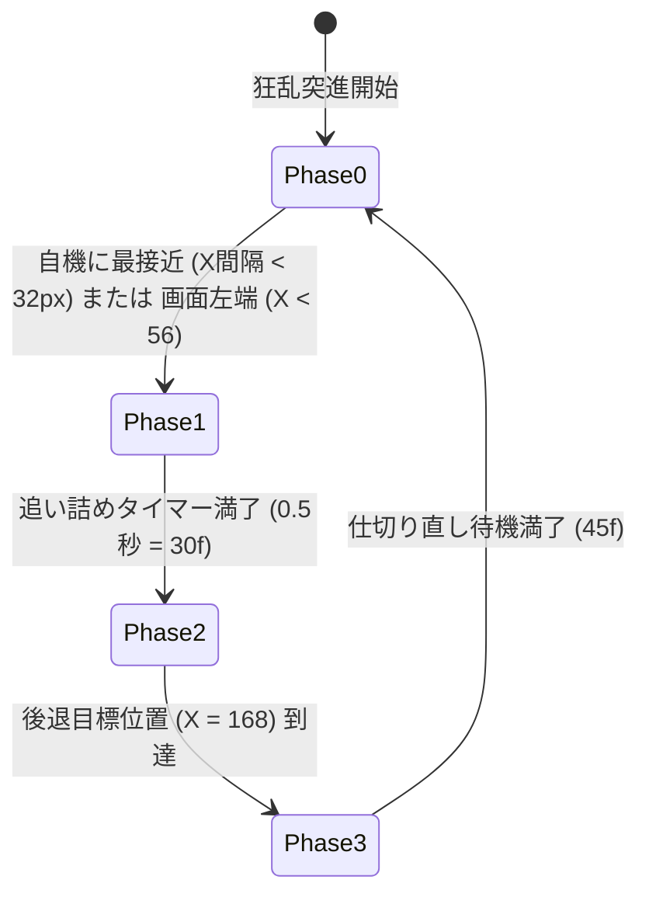
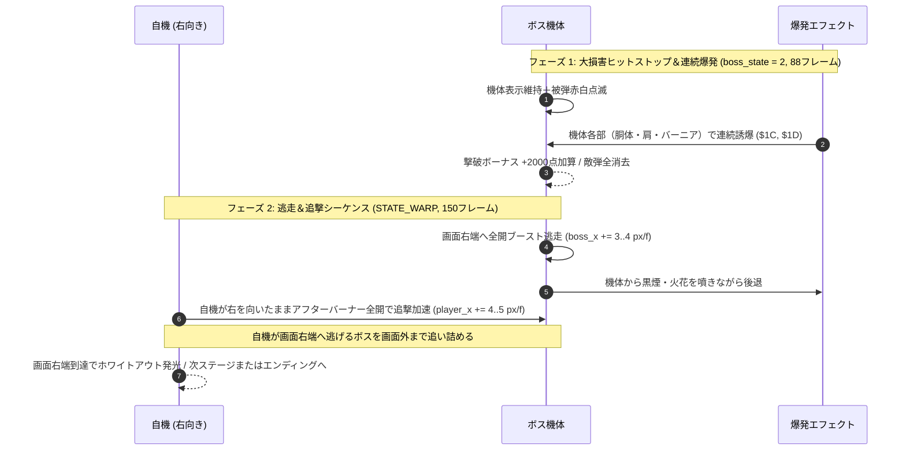

# MOJAxMOJA WARS (KBX-026 SAMURAI) 内部技術仕様書 (SPEC.md)

本ドキュメントは、ファミコン用縦スクロール＆横表示デュアル視点シューティングゲーム『MOJAxMOJA WARS』の完全なシステムアーキテクチャ、メモリマップ、数学的計算式、ハードウェア制御シーケンス、各種パラメータテーブルを網羅した内部技術仕様書である。

---

## 目次

1. [ハードウェア構成とROMメモリマップ](#1-ハードウェア構成とromメモリマップ)
2. [ゼロページ＆RAMメモリ配置](#2-ゼロページramメモリ配置)
3. [PPU描画エンジン＆デュアル視点システム](#3-ppu描画エンジンデュアル視点システム)
4. [自機 4形態ドッキング＆被弾パージシステム](#4-自機-4形態ドッキング被弾パージシステム)
5. [兵装パラメータ＆近接プラズマブレード決闘仕様](#5-兵装パラメータ近接プラズマブレード決闘仕様)
6. [敵勢力・編隊スポナー・味方輸送機アルゴリズム](#6-敵勢力編隊スポナー味方輸送機アルゴリズム)
7. [ボス戦AIステートマシン＆白兵戦ロジック](#7-ボス戦aiステートマシン白兵戦ロジック)
8. [APUサウンドエンジン仕様](#8-apuサウンドエンジン仕様)
9. [ステージマップバイナリ形式 (LVLMAP01)](#9-ステージマップバイナリ形式-lvlmap01)
10. [キャラクター OAM メタスプライトおよび CHR 仕様](#10-キャラクター-oam-メタスプライトおよび-chr-仕様)

---

## 1. ハードウェア構成とROMメモリマップ

### 1.1 カートリッジ仕様 (Mapper 0 / NROM-256)
- **PRG-ROM**: 32 KB ($8000 - $FFFF)
- **CHR-ROM**: 8 KB ($0000 - $1FFF)
- **ミラーリング**: 垂直ミラーリング (Vertical Mirroring)
- **IRQ**: APU Frame IRQ 無効化 ($4017 = $40)

### 1.2 PRG-ROM セグメント配置 (nes.cfg)
| アドレス範囲 | サイズ | セグメント名 | 内容 |
|---|---|---|---|
| `$8000 - $BFFF` | 16 KB | `CODE`, `RODATA` | ゲームロジック、テーブル、パレットデータ |
| `$C000 - $C7FF` | 2 KB | `DMCSEG` | DPCM ドラムサンプル (アドレス $C000 固定配置) |
| `$C800 - $FFF9` | 14 KB | `PRG2` | ステージマップ (LVLMAP01)、BGMデータ、追加コード |
| `$FFFA - $FFFF` | 6 Byte | `VECTORS` | NMI ($8082), RESET ($8000), IRQ/BRK ($808E) |

### 1.3 CHR-ROM パターンテーブル構成 (8KB)
- **Pattern Table 0 (`$0000 - $0FFF`)**: 縦スクロール道中用 (PT0)
  - `$00 - $0F`: 自機 (コア戦闘機/脚部/胸部/ホワイトセーバー), ミサイル, レーザー
  - `$10 - $2F`: 雑魚敵 4種, 味方支援機 (味方支援輸送機), 合体パーツ (脚部・胸部)
  - `$30 - $7F`: 背景星空、小惑星、コロニー壁面、軌道リング
  - `$80 - $DF`: HUD用 ASCII フォント (16進・英数・文字)
- **Pattern Table 1 (`$1000 - $1FFF`)**: 横表示 1-on-1 ボス決闘用 (PT1)
  - `$07`: 横画面用 極細ニードル通常ミサイル (横8×縦2px 水平弾)
  - `$09`: 横画面用 水平貫通荷電粒子ビームレーザー (横8×縦2px 水平光刃)
  - `$0A`: 横画面用 強化ミサイル (横8×縦6px 水平重弾頭)
  - `$00 - $2F`: 横向き自機 (各形態 24×24 / 24×32 分割スプライト)
  - `$30 - $47`: 中ボス 1 (重装兵型), 中ボス 2 (ホバー装甲型)
  - `$48 - $57`: 共通エフェクト・爆発・ボス弾
  - `$58 - $63`: 宿敵・紅蓮のMS (RIVAL RED MS - Mitame Sugoi 24×32 スプライト)
  - `$C0 - $DB`: 中ボス 3 (強襲クロー型), 中ボス 4 (電熱鞭機)
  - `$FE`: プラズマブレード斜め刀身タイル (`BEAM_SLIM_DIAG_8`)
  - `$FF`: プラズマブレード鍔・柄タイル (`SABER_HILT_8`)

---

## 2. ゼロページ＆RAMメモリ配置

### 2.1 ゼロページ (`$0000 - $00FF`) 主要変数
```
$00: nmi_ready        - 1=描画バッファ準備完了
$01: frame_count      - 毎フレームインクリメント (0..255)
$02: buttons          - 現在フレームのコントローラ1入力
$03: prev_buttons     - 前フレームのコントローラ1入力
$04: btn_press        - ボタン新規押下エッジ検出 (buttons & ~prev_buttons)
$05: rng_lo / $06: rng_hi - 16bit Galois LFSR 乱数レジスタ (タップ多項式 $B400)
$07: game_state       - 0=PLAYING, 1=WARP, 2=DEAD, 3=GAMEOVER, 4=TITLE, 5=ENDING, 6=BRIEFING
$08: state_timer      - 各ステート用汎用タイマー
$0A: menu_sel         - タイトル画面選択 (0=GAME START, 1=STAGE SELECT, 2=BOSS BATTLE)
$0B: boss_select      - ボス戦選択 (0..3=中ボス1..4, 4=宿敵・紅蓮のMS)
$0C: boss_battle_mode - 1=ボス戦単体モード (自機最初からホワイトセーバー形態)
$0D: current_stage    - ステージ番号 (0=MOON, 1=MARS, 2=JUPITER, 3=EARTH)
$0E: lives            - 残機数 (初期値 3)
$10: cam_nt / $11: cam_y - 縦スクロール用 ネームテーブル切替および垂直スクロール位置
$13: meta_idx         - 現在のステージ進行メタ行 (0..63)
$15: row_pending      - 1=NMIにて row_buf 転送待機中
$18: player_x / $19: player_y - 自機座標 (画面座標系 8bit)
$1A: weapon_type      - 4形態ビットマスク (0=CORE, 1=LEGS, 2=CHEST, 3=SABER)
$1B: weapon_level     - HUD表示用レベル (1..3)
$1C: rapid_level      - 連射速度レベル (1..5)
$1E: shot_timer       - 主兵装発射インターバル / 冷却タイマー
$1F: laser_timer      - 第3形態荷電粒子レーザー照射残り時間 (48..0)
$20: saber_timer      - プラズマブレードアニメーションタイマー (9..1)
$22: b_cooldown       - Bボタン範囲攻撃充填タイマー (120..0: 2秒充填)
$23: b_blast_timer    - Bボタン衝撃波残りフレーム (24..0)
$26: inv_timer        - 無敵時間残りフレーム
$27: ally_state       - 味方支援輸送機状態 (0=不在, 1=降下パーツ運搬, 2=投下後帰還)
$28: ally_x / $29: ally_y - 味方支援輸送機座標
$2A: ally_part        - 輸送中パーツ種別 (0=脚部, 1=胸部)
$2B: boss_state       - ボス状態 (0=不在, 1=通常戦闘, 2=撃破爆発, 3=WARNING, 4=登場, 5=近接白兵狂乱)
$2C: boss_type        - 0=量産型中ボス, 1=宿敵・紅蓮のMS
$2D: side_mode        - 0=縦スクロール道中(PT0), 1=横表示ロボット戦(PT1)
$2E: cam_x            - 横表示時の水平スクロール位置 ($2005 Xレジスタ)
$2F: warning_timer    - WARNING大警告タイマー (120..0)
$31: boss_hp          - ボス現在HP
$37: boss_max_hp      - ボス最大HP (狂乱近接移行 2/5 判定用)
$38: boss_beam_timer  - STAGE 4 大ボス 荷電粒子ビームタイマー
$39: boss_charge_phase- 近接突撃フェーズ (0=突進, 1=追い詰め0.5s, 2=離脱後退, 3=再チャージ待機)
$3A: boss_charge_timer- 近接フェーズ持続タイマー
$3B: boss_saber_stance- ボスプラズマブレード構え (0=上段の構え, 1=振り下ろし)
$3C: boss_saber_timer - ボスプラズマブレード構え切替タイマー (30..0: 0.5秒)
$44: score (6 bytes)  - 6桁10進スコアバッファ (BCD加算)
```

### 2.2 システムRAM (`$0200 - $07FF`) 配置
- `$0200 - $02FF`: シャドウ OAM バッファ (64スプライト × 4バイト)
- `$0300 - $031F`: `row_buf` (縦スクロール用 1行 32タイル展開バッファ)
- `$0320 - $035F`: 自機弾プール (`MAX_PBULLETS = 8`)
- `$0360 - $039F`: 敵機プール (`MAX_ENEMIES = 6`)
- `$03A0 - $03DF`: 敵弾プール (`MAX_EBULLETS = 6`)
- `$03E0 - $03FF`: アイテムプール (`MAX_ITEMS = 2`)

---

## 3. PPU描画エンジン＆デュアル視点システム



### 3.1 縦スクロール道中モード (`side_mode = 0`)
- **PPUレジスタ設定**:
  - `PPUCTRL = %10010000` (NMI有効, スプライト 8x8, BG = $0000, SP = $1000)
  - `PPUMASK = %00011110` (BG/スプライト表示, 左端8pxクリップ無効)
- **ネームテーブル・ストリーミング**:
  - 1フレームあたり `cam_y` が減算 (上方向へ進む)。
  - `meta_sub_row` が更新されるたびに、ステージマップから32タイル分を `row_buf` に解凍。
  - VBlank 中に 32 バイトを一括で画面外の先頭行 (`row_ppu_hi`, `row_ppu_lo`) へ書き込み。

### 3.2 横表示ロボット決闘モード (`side_mode = 1`)
- **PPUレジスタ設定**:
  - `PPUSCROLL = cam_x, 0`
  - スプライトバンクを PT1 (`$1000-$1FFF`) のサイドビューMS (Mitame Sugoi) バンクに切り替え。
- **スプライト構成 (24×24 / 24×32 ドット)**:
  - 8×8 ハードウェアスプライトを縦3〜4枚、横3枚並べて1体のロボットを構成。
  - 自機側は右向き (Attribute 0)、敵ボス側は左向き (Attribute 水平反転 `%01000000`)。

---

## 4. 自機 4形態ドッキング＆被弾パージシステム

### 4.1 形態ビットマスク演算
自機の合体状態は `weapon_type` の下位2ビットで保持される。

$$\text{weapon\_type} = (\text{Chest} \ll 1) \mid \text{Legs}$$

| 形態 | `weapon_type` | ビット | 名称 | 主兵装 | アーマー耐久 |
|---|---|---|---|---|---|
| 初期形態 | `0` | `00b` | コア戦闘機 | 単装通常ミサイル (小型 / 1dmg) | 0 (被弾で即撃墜) |
| 第2形態 | `1` | `01b` | コア＋脚部 | 強化ミサイル (中型直進 / 2dmg) ※3-WAY廃止 | 1層 (被弾でコアへ) |
| 第2.5形態 | `2` | `10b` | コア＋胸部 | 2-WAY 通常ミサイル (小型×2 / 1dmg×2) | 1層 (被弾でコアへ) |
| 第3形態 | `3` | `11b` | ホワイトセーバー (完全合体) | 画面貫通荷電粒子レーザー (2dmg/tick) | 2層 (被弾で脚部形態へ) |

### 4.2 パーツ合体アルゴリズム (`apply_powerup`)
味方支援機から投下されたパーツ (`item_type`: 0=脚部, 1=胸部) を取得したときの処理:
```assembly
apply_powerup:
    and #1
    clc
    adc #1              ; 脚部なら %01 (1), 胸部なら %10 (2)
    ora weapon_type     ; 現在の形態ビットと論理和合成
    cmp weapon_type
    bne @form_changed
    ; 既に装着済みのパーツの場合は +500点 ボーナス加算
    lda #5
    jsr add_score_hundreds
    rts
@form_changed:
    sta weapon_type
    ; weapon_level を更新し、ドッキング効果音 (SFX_DOCK) とホワイトフラッシュ (kill_flash = 2) を再生
```

### 4.3 段階的アーマーパージ被弾処理 (`hit_player`)


---

## 5. 兵装パラメータ＆近接プラズマブレード決闘仕様

### 5.1 兵装定数一覧
| 兵装名 | 攻撃力 | 判定サイズ (W×H) | 速度 (VX, VY) | 貫通性能 | クールダウン / 持続時間 | 備考 |
|---|---|---|---|---|---|---|
| 通常ミサイル | `DMG_MISSILE = 1` | 2×8 px (極細) | (0, -4) | なし | 6〜10 フレーム | 初期形態・第2.5形態用。幅2pxの極細ニードル弾。横判定幅を8pxに縮小（横画面時は PT1 $07: 横8×縦2px 水平弾） |
| 強化ミサイル | `DMG_HEAVY_MISSILE = 2` | 6×8 px (標準) | (0, -4) | なし | 8〜12 フレーム | 第2形態用。従来の通常ミサイルサイズ（幅6px）。3-WAY拡散弾は廃止（横画面時は PT1 $0A: 横8×縦6px 水平弾） |
| 2-WAY ミサイル | `DMG_MISSILE = 1` × 2 | 2×8 px × 2 | 左右並列 (0, -4) | なし | 6〜10 フレーム | 第2.5形態用。極細ニードル通常ミサイルを左右2門から同時発射（横画面時は上下2連水平弾） |
| 荷電粒子レーザー | `DMG_LASER_TICK = 2` | 8×180 px | (0, -10) | 全画面敵貫通 | 照射 48f (約0.8s) / 冷却 42f (0.7s) | 第3形態用 |
| プラズマ衝撃波 (B) | `DMG_PLASMA = 5` | 半径 76px (全周囲) | 即時全域判定 | 敵弾100%消去 | 充填 120f (2.0s) / 演出 24f | 全形態共通（緊急回避） |
| 近接プラズマブレード | `DMG_SABER = 8` | 46×44 px | 手元から前方展開 | 敵弾消滅＋大ダメージ | 3コマ 9f / 冷却 12f | 第3形態・横ボス戦白兵用 |

### 5.2 近接プラズマブレード判定ロジック
横表示ボス戦 (`side_mode = 1`) の白兵戦では、以下の矩形交差アルゴリズムにより敵弾の即時消去および大ダメージ判定が行われる。

#### 自機プラズマブレード判定範囲:
- 水平距離: $0 \le (\text{boss\_x} - \text{player\_x}) < 47\text{ px}$
- 垂直距離: $-8 \le (\text{player\_y} - \text{boss\_y}) < 37\text{ px}$
- コマ2初撃フレーム (`saber_timer == 6`) に `DMG_SABER = 8` をボスに直接減算。
- 斬撃範囲内に存在する敵弾 (`ebul_flag[i]`) は即座にフラグクリア消滅。

#### ボス・自機 白兵戦構えステートマシン:
- **上段の構え (`boss_saber_stance = 0`)**:
  - タイマー 30フレーム (0.5秒)。
  - ブレードを頭上に掲げ、切っ先を天に向けた構え。
- **振り下ろし一閃 (`boss_saber_stance = 1`)**:
  - タイマー 30フレーム (0.5秒)。
  - 上段から袈裟懸け・水平前方へ力強く刀身を振り下ろす。
- **自機 (第3形態 ホワイトセーバー)**:
  - Aボタン未押下: 上段の構えを維持して牽制。
  - Aボタン押下: 瞬時に振り下ろし一閃！刀身を展開して敵弾を弾き飛ばしつつ大打撃を与える。

---

## 6. 敵勢力・編隊スポナー・味方輸送機アルゴリズム

### 6.1 敵機仕様 (MOJAxMOJA 地球外生命体)
| 敵種別 | コード | HP | 移動ルーチン | 攻撃パターン |
|---|---|---|---|---|
| 小型偵察モジャ | `ENEMY_SCOUT` | 1 | 画面上方から等速垂直降下 (VY = +2) | 自機狙い弾 1発 |
| サイン機動モジャ | `ENEMY_SWOOP` | 1 | サイン波テーブルによる左右往復降下 | 垂直落下弾 |
| 高速突撃モジャ | `ENEMY_CHARGER` | 1 | 自機X座標を追従ホーミングしながら急降下 (VY = +4) | 弾なし (体当たり特化) |
| 重装砲台モジャ | `ENEMY_TURRET` | 2 | 画面中央付近で停止 (VY = 0) | 2連扇状ばらまき弾 |

### 6.2 3機編隊スポナー (`spawner_cnt`, `spawner_timer`)
4メタ行ごと、または特定フィーチャー行でトリガー:
- `spawner_cnt`: 3機カウントダウン。
- `spawner_timer`: 12フレームごとに次機をスポーン。
- 編隊パターン: V字降下、サイン波追従、縦一列突撃の3種を乱数で決定。

### 6.3 味方支援輸送機 補給シーケンス
- **出現契機 1**: `meta_idx == 27` (中ボスの5メタ行手前)
- **出現契機 2**: `meta_idx == 58` (大ボスの5メタ行手前)
- **動作フェーズ**:
  1. `ally_state = 1`: 画面最上部から自機X座標へ徐々に吸い寄せられながら Y=76 まで降下。
  2. `Y == 76` 到達: 懸吊していた合体パーツを切り離して投下 (`spawn_powerup_item`)。
  3. `ally_state = 2`: 速度 2px/frame で上空へ垂直反転上昇し、画面外へ離脱。
  4. 連動機構: 脚部パーツをドッキングすると、即座に第2陣として胸部パーツ輸送機が出撃。

---

## 7. ボス戦AIステートマシン＆白兵戦ロジック

### 7.1 ボス登場一覧
| 区分 | 登場ステージ | 名称 / モデル | 最大HP | 固有攻撃パターン |
|---|---|---|---|---|
| 中ボス 1 | Stage 1 (月) | 重装兵型 (MOJA-01 TROOPER) | 30 | マシンガン単装射撃 |
| 中ボス 2 | Stage 2 (火星) | ホバー装甲型 (MOJA-02 HOVER) | 35 | 拡散荷電粒子砲・2連弾 |
| 中ボス 3 | Stage 3 (木星) | 強襲クロー型 (MOJA-03 CLAW) | 40 | クロービーム・上下ジグザグ移動 |
| 中ボス 4 | Stage 4 (地球) | 電熱鞭機 (MOJA-04 WHIP) | 50 | プラズマウィップ連射・高速左右揺動 |
| 宿敵ボス | 全ステージ終端 | 宿敵・紅蓮のMS (RIVAL RED MS - Mitame Sugoi) | 80/90/100/120 | 3倍速機動、近接プラズマブレード突進、荷電粒子砲 |

### 7.2 近接白兵狂乱モード (HP $\le$ 40%)
ボスの現在HPが最大値の 2/5 以下になると、AIは通常の射撃戦から近接白兵モード (`boss_state = 5`) へ遷移する。



#### 「いったん引く」追い詰め脱出アルゴリズム:
自機が画面左端 ($X < 56$) に追い詰められた場合、ボスの攻撃がハメ状態になるのを防ぐため、追い詰めフェーズ (`boss_charge_phase = 1`) は最大 30フレーム (0.5秒) で強制終了する。
終了後、ボスは後退フェーズ (`boss_charge_phase = 2`) に入り、右方向へ後退して $X = 168$ まで一旦距離を取る。これによりプレイヤーは左端から脱出し、上下に体勢を立て直す隙が保証される。

### 7.3 Stage 4 大ボス: 荷電粒子ビーム砲
Stage 4 の宿敵・紅蓮のMS戦でのみ発動する大技。
1. **チャージ (45フレーム)**: 画面が赤点滅し、高音の警告アラートが連続吹鳴。
2. **照射 (36フレーム)**: 画面右端から左端まで一瞬で到達する極太ビーム帯を照射。上下に退避していない自機は即座に被弾する。

### 7.4 ボス撃破・大損害逃走＆自機追撃シーケンス
ボス（中ボス・宿敵大ボス）のHPが0になった際、ボスを消滅させずに「撤退せざるを得ない致命的損害」を表現する撃破・逃走シーケンスを実行する。



#### 演出パラメータ仕様:
1. **ボス機体表示維持**:
   - `boss_state = 2`（撃破演出中）および逃走中、ボススプライトを消去せず表示を維持。
   - 交互点滅（`boss_flash`）と連続多重爆発スプライト（$1C, $1D）を重ねて大破状態を演出。
2. **退却逃走移動**:
   - ボスは姿勢を維持したまま、画面右端（$X \ge 248$）へ向かって高速後退（$VX = +3 \sim +4$）。
3. **自機追撃演出**:
   - 従来の「画面上中央への離脱」を廃止。
   - 自機は横視点（右向き）姿勢を維持し、ボスのY軸ラインへ軽くアライメントを合わせながら、ボス以上の猛スピード（$VX = +4 \sim +5$）で画面右端へ一直線に追撃突進。
   - 両機が画面外へ到達した時点でホワイトアウトし、次ステージへ切り替える。

---

## 8. APUサウンドエンジン仕様

### 8.1 チャンネル構成と役割
- **Pulse 1 ($4000-$4003)**: 主旋律メロディ、リードシンセ
- **Pulse 2 ($4004-$4007)**: 和音バッキング、効果音 (SFX) 割り込み再生
- **Triangle ($4008-$400B)**: ベースライン (音量固定、16ステップアルペジオ)
- **Noise ($400C-$400F)**: ハイハット、スネアドラム、爆発音
- **DMC ($4010-$4013)**: DPCM キックドラム ($C000-$C7FF サンプル再生)

### 8.2 BGM トラックリスト
全曲 4チャンネル（Pulse 1, Pulse 2, Triangle, Noise）＋ DPCM ドラムによるパターンシーケンサー（`tools/gen_music.py` 自動生成）で再生される。

| トラック番号 | 定数名 | 曲名・モチーフ | 特徴 |
|---|---|---|---|
| 1 | `TRACK_TITLE` | SPACE MERCHANT - THE SYONIN | 130 BPM (7 f/step) イースII「THE SYONIN」風の軽妙なスキップと跳ねるような商人テーマ (F → Bb → C → F) |
| 2 | `TRACK_STAGE1` | LUNAR CATACOMB DRIVE | 150 BPM (6 f/step) D minor 哀愁を帯びた高速メロディ、16分オクターブ＆ギャロップベース、DPCMドラム（全ステージ道中共通） |
| 3 | `TRACK_STAGE2` | LUNAR CATACOMB DRIVE (共通) | 150 BPM (6 f/step) ※現状は個別曲を持たず、`TRACK_STAGE1` と同一の小節データ（`assets/music_stage.s`）を再生 |
| 4 | `TRACK_BOSS` | CRIMSON BATTLE GROUND | 180 BPM (5 f/step) E minor イースII「BATTLE GROUND」風 超高速スラッシュビート＆激しいリード |
| 5 | `TRACK_CLEAR` | INTRODUCTION!! - WARP OVERDRIVE | 150 BPM (6 f/step) E minor 『Introduction!!』風 4ch＋DPCM 疾走ファンファーレ＆クリスタル分散和音（全4小節。ワープ追撃2.5s〜ブリーフィング3.9sを連動再生） |
| 6 | `TRACK_GAMEOVER`| TEARS OF SYLPH (哀惜の詩) | 69.3 BPM (13 f/step) Ys風 哀愁バラード旋律（Pulse 1 主旋律＋Pulse 2 和音アルペジオ＋Triangle 下行ベース） |

### 8.3 効果音 (SFX) 定数・発音仕様
SFX は Pulse 2 および Noise チャンネルを一時的に占有して再生される。効果音タイマー満了で自動的に BGM 出力へ復帰する。

| 効果音定数 | 名称・用途 | チャンネル | タイマー | 音響特徴 |
|---|---|---|---|---|
| `SFX_SHOT` (1) | 通常弾発射 | Pulse 2 | 10f | 高音から急速ピッチダウンするミサイル射出音 |
| `SFX_LASER` (2) | 荷電粒子レーザー | Pulse 2 | 10f | 高周波シャープ閃光音 |
| `SFX_BOMB` (3) | プラズマ衝撃波 (B) | Pulse 2 + Noise | 24f | 巨大うねり音＋広域爆轟 |
| `SFX_HIT` (4) | 敵被弾ヒット | Noise | 6f | 短いパチパチ音 ($02) |
| `SFX_EXPLODE` (5) | 敵機撃破・大爆発 | Noise | 24f | アタック炸裂 ($07) → 重低音 ($0B) → 余韻 ($0E) へのピッチスイープ大爆破音 |
| `SFX_POWERUP` (6) | パーツ取得・チャイム | Pulse 2 | 20f | 上昇アルペジオチャイム |
| `SFX_DEAD` (7) | 自機撃墜・大破ミス | Pulse 2 + Noise | 48f | 矩形波急降下クラッシュ音 ＋ 金属激震ロング大爆轟 ($8A→$0B→$0F) |
| `SFX_WARP` (8) | ワープ・急加速 | Pulse 2 | 40f | 高音スイープ加速音 |
| `SFX_DOCK` (9) | ドッキング合体 | Pulse 2 + Noise | 28f | 重厚クラッチ衝撃音 ＋ 金属ラッチ「ガッ・シャン！！」 |
| `SFX_1UP` (10) | 20,000点 1UP ファンファーレ | Pulse 2 | 56f | 「ぱぱぱぱーん。」（20,000点到達ごとの1UP告知） |


---

## 9. ステージマップバイナリ形式 (LVLMAP01)

### 9.1 マップヘッダ構造 (ROM Offset `$3BCC`)
```
+00: 'L' 'V' 'L' 'M' 'A' 'P' '0' '1' (8バイト マジックID)
+08: ステージ数 (4)
+09: 1ステージあたりメタ行数 (64)
+0A: 予約 (6バイト)
```

### 9.2 メタ行バイトフォーマット
各ステージは 64 バイトの配列で構成され、各バイトが 1 メタ行 (縦 16px 分) の地形およびイベントを定義する。

| ビット | 項目 | 内容 |
|---|---|---|
| `bit 7..4` | 地形フィーチャー | 0=宇宙空間, 1=小惑星帯, 2=宇宙要塞壁面, 3=コロニー内部, 4=地球大気圏, 5=軌道リング |
| `bit 3..0` | イベントトリガー | 0=通常, 1=編隊急襲, 2=味方補給ポイント, 3=中ボスWARNING, 4=大ボスWARNING |

- **メタ行 27**: 味方輸送機 (脚部パーツ) トリガー
- **メタ行 32**: 中ボス戦 WARNING トリガー
- **メタ行 58**: 味方輸送機 (大ボス前再補給) トリガー
- **メタ行 63**: 宿敵・紅蓮のMS戦 WARNING トリガー

### 9.3 拡張ステージ仕様パラメータテーブル (16バイト: ROMオフセット LVLMAP01 + 264)
Webステージエディタ (`docs/editor/`) から直接編集して `.nes` ROMへ書き込み可能なパラメータ配列。
- `level_spawner_timer` (4バイト): 3機編隊スポナー生成間隔フレーム数 (Stage 1〜4: デフォルト 12, 12, 10, 8)
- `level_bullet_speed` (4バイト): 敵通常弾 縦速度 (Stage 1〜4: 1, 2, 2, 3 px/frame)
- `level_frenzy_threshold` (4バイト): ボス狂乱近接突進モード突入 HP比率 (2=2/5[40%], 3=3/5[60%])
- `level_corner_retreat_limit` (4バイト): ボス追い詰め脱出リミットフレーム数 (デフォルト 30フレーム = 0.5秒)

### 9.4 Webステージエディタとソースコードの連携
- Webステージエディタの「**📤 ca65 ASM 出力**」を使用すると、全4面のマップ配列（256バイト）および上記パラメータテーブル（16バイト）が `assets/stages.s` のフォーマットで即時生成される。
- これをプロジェクト内の `assets/stages.s` に上書きして再ビルド（`make` / `ninja`）することで、エディタで作成したステージ構成がゲーム本体の標準仕様として恒久反映される。
- エディタの詳しい操作手順、実機タイムライン（1列=144フレーム/2.4秒）、ボス交戦区間等の仕様は [docs/editor/manual.html](editor/manual.html) を参照。

## 10. キャラクター OAM メタスプライトおよび CHR 仕様

### 10.1 Webキャラクターエディタ (`docs/character-editor/`)
- ブラウザ上でPNG画像をドラッグ＆ドロップしてNESマスター54色から「透明1色＋3色」へ自動減色し、8x8タイルへ自動分解する公式グラフィックオーサリング環境。
- 操作マニュアルは [docs/character-editor/manual.html](character-editor/manual.html) を参照。

### 10.2 ハードウェア制約とエディタのガード機能
1. **スプライト CHR 容量**:
   - NROM-256 のスプライトパターンテーブル（バンク0: `$0000-$0FFF`）は最大 256 個の 8x8 タイル（4KB）。
   - 空タイル除外と重複タイルの統合（重複排除）を行い、ヘッダーの「スプライト CHR メーター」でリアルタイム監視。
2. **水平スキャンライン 8 スプライト制限**:
   - PPU の水平 1 ラインあたり最大 8 スプライト制限に対し、スキャンラインルーラーで重なり枚数を解析しチラつき発生ラインを警告表示。
3. **パレット制限**:
   - スプライトサブパレット 0〜3（各4色：透明1色＋3色）。パレット番号差し替えによる色違い敵キャラの複製をサポート。

### 10.3 データ出力形式
- **`character_data.s`**: RODATAセグメント。フレームごとのスプライト枚数、`(RelY, TileID, Attr, RelX)` 配列、および AABB 食らい判定・攻撃判定テーブル（中心相対の Half-W, Half-H）。
- **`character_tiles.s`**: CHRセグメント。2bpp形式（Plane 0 8バイト + Plane 1 8バイト = 16バイト/タイル）。
- **`characters.json`**: プロジェクト完全保存用およびステージエディタ（`docs/editor/`）連携用。


