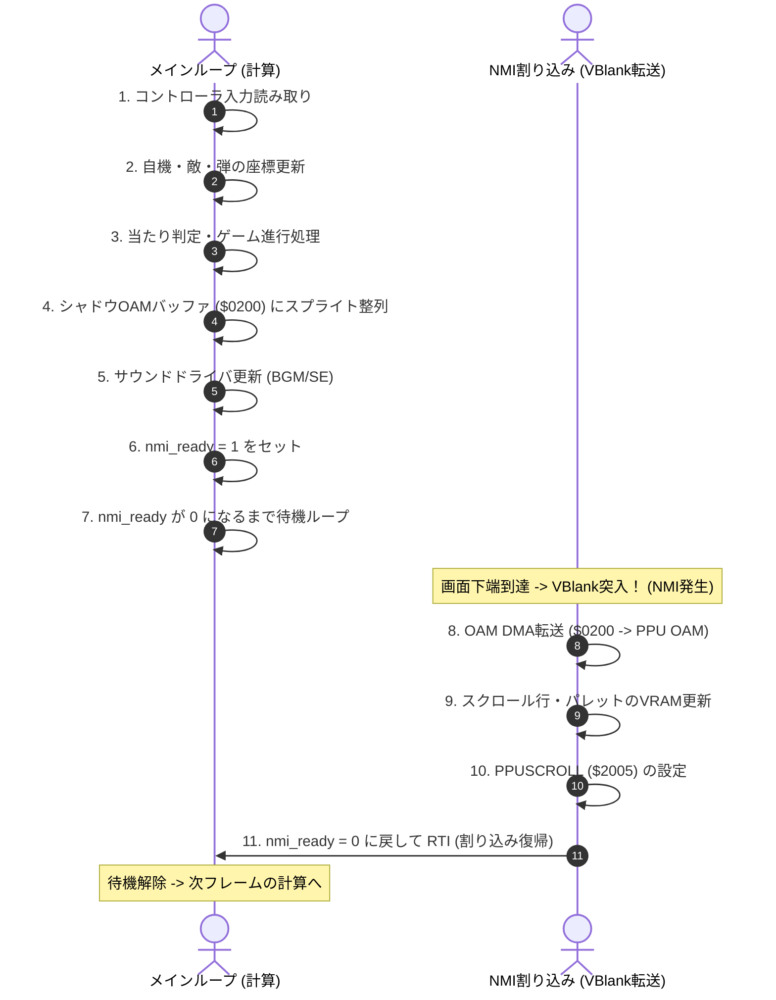
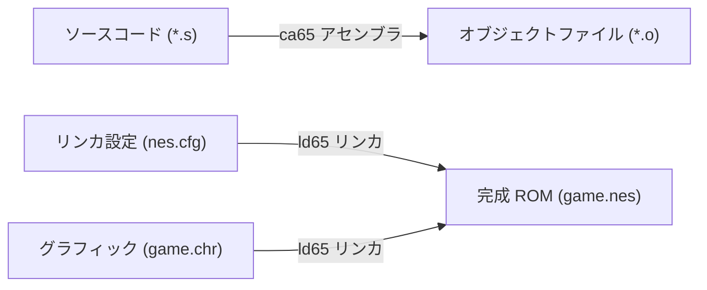

# ファミコンゲーム開発 初心者向け技術説明書
**〜 実践コード（6502アセンブラ）で学ぶファミコンのアーキテクチャと実装技法 〜**

---

## はじめに

本書は、ファミリーコンピュータ（以下、ファミコン / 海外名 NES: Nintendo Entertainment System）向けのゲームプログラミングを始めたい開発初心者を対象とした技術解説書です。

本リポジトリの実装である**『MOJAxMOJA WARS』**（縦スクロール＆横画面ロボット戦闘シューティング）のソースコード（6502アセンブラ / `ca65`）を実例として引用しながら、ファミコン独特のハードウェアアーキテクチャ、画面描画（PPU）、コントローラ入力、キャラクタ操作、サウンド再生（APU）の仕組みをゼロから分かりやすく解説します。

---

## 目次

1. [ファミコンの基本アーキテクチャ](#1-ファミコンの基本アーキテクチャ)
   - [3大主要チップ（CPU・PPU・APU）の役割](#11-3大主要チップの役割)
   - [ハードウェア全体ブロック図](#12-ハードウェア全体ブロック図)
   - [メモリマップの構造（CPU空間とPPU空間）](#13-メモリマップの構造)
   - [VBlank（垂直帰線区間）とNMI割り込みの鉄則](#14-vblank垂直帰線区間とnmi割り込みの鉄則)
2. [ゲームプログラムの全体骨格とメインループ](#2-ゲームプログラムの全体骨格とメインループ)
   - [6502アセンブラ超入門（頻出命令クイックガイド）](#21-6502アセンブラ超入門頻出命令クイックガイド)
   - [ソースコード構成](#22-ソースコード構成)
   - [リセットベクタとハードウェア初期化手順](#23-リセットベクタとハードウェア初期化手順)
   - [VBlank同期型メインループの設計](#24-vblank同期型メインループの設計)
3. [画面描画の仕組み (PPU: Picture Processing Unit)](#3-画面描画の仕組み-ppu)
   - [パターンテーブル（CHR ROM）：タイルの正体](#31-パターンテーブルchr-romタイルの正体)
   - [ネームテーブルとアトリビュートテーブル（BG背景描画）](#32-ネームテーブルとアトリビュートテーブルbg背景描画)
   - [パレット構造（BG用4本・スプライト用4本）](#33-パレット構造)
   - [スプライト描画と高速OAM DMA転送（$4014）](#34-スプライト描画と高速oam-dma転送4014)
   - [ファミコンの限界：8スプライト制限とローテーション対策](#35-ファミコンの限界8スプライト制限とローテーション対策)
   - [スクロールレジスタ（$2005）と画面遷移](#36-スクロールレジスタ2005と画面遷移)
4. [コントローラ入力ハンドリング](#4-コントローラ入力ハンドリング)
   - [標準コントローラのシリアル通信プロトコル](#41-標準コントローラのシリアル通信プロトコル)
   - [8回シフトによる入力取得（リングカウンタ技法）](#42-8回シフトによる入力取得リングカウンタ技法)
   - [押下瞬間（トリガー）と長押し（ホールド）の判定ロジック](#43-押下瞬間トリガーと長押しホールドの判定ロジック)
5. [キャラクタ操作とゲームロジック](#5-キャラクタ操作とゲームロジック)
   - [自機の移動と画面端のクリッピング（衝突制限）](#51-自機の移動と画面端のクリッピング)
   - [整数演算しかないファミコンでの「小数速度（1.5px/f）」表現](#52-整数演算しかないファミコンでの小数速度表現)
   - [当たり判定（AABB：矩形衝突判定）](#53-当たり判定aabb矩形衝突判定)
   - [シャドウOAMへのスプライト展開](#54-シャドウoamへのスプライト展開)
6. [サウンド・音楽再生の仕組み (APU: Audio Processing Unit)](#6-サウンド音楽再生の仕組み-apu)
   - [ファミコン音源の5チャンネル構成](#61-ファミコン音源の5チャンネル構成)
   - [サウンドドライバの基本アーキテクチャ](#62-サウンドドライバの基本アーキテクチャ)
   - [BGMシーケンサー（Tick・Step・周波数ルックアップ）](#63-bgmシーケンサー)
   - [効果音（SE）によるチャンネル横取りと復帰処理](#64-効果音seによるチャンネル横取りと復帰処理)
7. [開発環境と初心者がハマる罠 TOP 5](#7-開発環境と初心者がハマる罠-top-5)
   - [ビルド環境（ca65 + ld65 + nes.cfg）](#71-ビルド環境)
   - [初心者が必ずハマるファミコン開発の落とし穴](#72-初心者が必ずハマるファミコン開発の落とし穴)

---

## 1. ファミコンの基本アーキテクチャ

### 1.1 3大主要チップの役割

ファミコン内部は、主に以下の3つの要素で構成されています。

| 要素 | 名称 | 役割と特徴 |
| :--- | :--- | :--- |
| **CPU** | Ricoh 2A03 (MOS 6502互換) | クロック周波数 約1.79MHz（NTSC）。8ビットCPU。アキュムレータ(A)、インデックスレジスタ(X, Y)、スタックポインタ(S)、ステータスフラグ(P)、プログラムカウンタ(PC)を持つ。乗除算命令や十進モード（BCD）は省かれている。 |
| **PPU** | Ricoh 2C02 | クロック周波数 約5.37MHz。画面描画専用の画像処理チップ。解像度 256×240 ピクセル、同時発色数 最大25色（全54色中）を生成する。 |
| **APU** | CPU内に内蔵 | 音声生成ユニット。矩形波2音、三角波1音、ノイズ1音、DPCMサンプリング音1音の計5チャンネルを制御する。 |

> [!IMPORTANT]
> **CPUとPPUは完全に独立した別々のメモリ空間を持っています。**  
> CPUはPPUのVRAMを直接メモリアドレスとして読む/書くことはできません。CPU空間に割り当てられた **PPUレジスタ（$2000〜$2007）** を経由してデータをやり取りします。

---

### 1.2 ハードウェア全体ブロック図

```
+-----------------------------------------------------------+
|                        ファミコン本体                      |
|                                                           |
|   +-------------------+          +--------------------+   |
|   |     CPU 2A03      |          |      PPU 2C02      |   |
|   |  (1.79MHz 8bit)   |          |    (描画プロセッサ)  |   |
|   |                   |          |                    |   |
|   |  [内蔵 APU 音源]   |          +---------+----------+   |
|   +---------+---------+                    |              |
|             | CPUバス                      | PPUバス      |
|    +--------+--------+            +--------+--------+     |
|    |                 |            |                 |     |
| +--+----+       +----+---+     +--+----+       +----+---+ |
| | CPU   |       | コント |     | PPU   |       | カート | |
| | RAM   |       | ローラ |     | VRAM  |       | リッジ | |
| | (2KB) |       | ($4016)|     | (2KB) |       | (CHR)  | |
| +-------+       +--------+     +-------+       +--------+ |
|                                                           |
+-----------------------------------------------------------+
```

---

### 1.3 メモリマップの構造

#### ■ CPUメモリ空間 ($0000〜$FFFF : 64KB)

ファミコンのCPUが見ているメモリ空間の割り当てです。

```text
$0000 +--------------------------------+
      | ゼロページ (Zero Page: 256B)   |  <- 最速アクセス可能な特殊RAM領域
$0100 +--------------------------------+
      | CPUスタック領域 (Stack: 256B)  |  <- JSR, RTS, PHA, PLA, 割り込み等で使用
$0200 +--------------------------------+
      | シャドウOAMバッファ (256B)     |  <- 本作ではスプライト64機分の退避領域として使用
$0300 +--------------------------------+
      | 汎用RAM ($0300-$07FF: 1280B)   |  <- ゲーム内変数、敵・弾などの配列
$0800 +--------------------------------+
      | (RAMのミラー領域 $0800-$1FFF)  |
$2000 +--------------------------------+
      | PPUレジスタ ($2000-$2007)      |  <- PPUCTRL, PPUMASK, PPUSTATUS, PPUADDR, PPUDATA 等
$4000 +--------------------------------+
      | APU / IOレジスタ ($4000-$4017) |  <- 音源レジスタ、OAMDMA ($4014)、パッド ($4016)
$8000 +--------------------------------+
      | PRG ROM (プログラムコード)     |  <- カートリッジのROM (32KB〜)
$FFFA +--------------------------------+
      | 割り込みベクタ (NMI, RES, IRQ) |  <- $FFFA: NMI, $FFFC: RESET, $FFFE: IRQ
$FFFF +--------------------------------+
```

> [!TIP]
> **ゼロページ ($0000〜$00FF) が特別な理由**  
> 6502アセンブラでは、アドレス上位が `$00` である領域に対して専用命令（例: `LDA $10`）が用意されており、通常のメモリアクセス（例: `LDA $0310`）より命令サイズが1バイト短く、実行クロックも1サイクル高速です。  
> ゲーム内で頻繁に計算する座標変数やポインタはゼロページに配置するのが鉄則です。

#### ■ PPUメモリ空間 ($0000〜$3FFF : 16KB)

PPUが画面を描画するために参照する専用メモリ空間です。

```text
$0000 +--------------------------------+
      | パターンテーブル 0 (CHR 4KB)   |  <- スプライト用またはBG用のタイル画像(256個)
$1000 +--------------------------------+
      | パターンテーブル 1 (CHR 4KB)   |  <- BG用またはスプライト用のタイル画像(256個)
$2000 +--------------------------------+
      | ネームテーブル 0 (BG画面 1KB)  |  <- 32×30タイル + アトリビュート(パレット属性)
$2400 +--------------------------------+
      | ネームテーブル 1 (BG画面 1KB)  |  <- 画面スクロール用の2枚目画面
$2800 +--------------------------------+
      | ネームテーブル 2 (BG画面 1KB)  |  <- 垂直スクロール時に利用（ミラーリング設定による）
$2C00 +--------------------------------+
      | ネームテーブル 3 (BG画面 1KB)  |
$3F00 +--------------------------------+
      | パレットRAM ($3F00-$3F1F: 32B) |  <- BGパレット16バイト + スプライトパレット16バイト
$3FFF +--------------------------------+
```

> [!IMPORTANT]
> **初心者が驚く「VRAMは実は2KBしかない」という真実とミラーリング**  
> PPUのアドレス空間上にはネームテーブルが4画面分（$2000, $2400, $2800, $2C00）並んでいますが、**ファミコン本体に内蔵されているVRAM（CIRAM）は 2KB（2画面分）しかありません！**  
> そのため、残りの2画面はどちらかの画面の「鏡像（ミラー）」として結線されています。
> 
> - **水平ミラーリング (Horizontal Mirroring)**:  
>   左右が同一内容になり、**上下（$2000 と $2800）が独立した別画面** になります。  
>   👉 **『縦スクロールゲーム』に必須の設定**（本作 `MOJAxMOJA WARS` もこれを使用！ `header.s` で指定）。  
> - **垂直ミラーリング (Vertical Mirroring)**:  
>   上下が同一内容になり、**左右（$2000 と $2400）が独立した別画面** になります。  
>   👉 『横スクロールゲーム』（マリオブラザーズ等）で使用されます。  
> 
> ※「縦スクロールなのに『水平』ミラーリング」と呼ばれるのは、「水平方向に並んだネームテーブル同士が同じ内容（ミラー）になる」というハードウェアの結線名に基づいているためです。初心者が最も混乱しやすいポイントなので覚えておきましょう！

---

### 1.4 VBlank（垂直帰線区間）とNMI割り込みの鉄則

ファミコンの画面描画は、ブラウン管テレビの走査線に合わせて毎秒約60回（60fps）行われます。

1. **描画期間（アクティブスキャンライン: 0〜239行目）**  
   PPUがVRAMからタイルデータを読み出し、画面に絵を描いている最中。  
   **この期間中にCPUがPPUレジスタ（$2006/$2007）を触ると、画面が激しく乱れたりデータが破損します。**
2. **VBlank期間（垂直帰線区間: 240〜261行目 / 約2270サイクル）**  
   PPUが画面最下部まで描き終え、電子銃が画面左上に戻るまでのわずかな空白時間（約1.3ミリ秒）。  
   **画面の書き換え（OAM DMA転送、パレット更新、スクロール位置変更、VRAMタイル転送）は、このVBlank期間内にすべて終わらせなければなりません！**

PPUはVBlankに入った瞬間にCPUに対して **NMI（Non-Maskable Interrupt: 変更不可割り込み）** を発行します。ファミコンゲームはこのNMIを契機にして1フレームの描画同期を行います。

---

## 2. ゲームプログラムの全体骨格とメインループ

### 2.1 6502アセンブラ超入門（頻出命令クイックガイド）

ファミコンのCPUコードを読むにあたり、最低限知っておくと理解が劇的に深まる主要なレジスタと命令です。

#### ■ CPU内部レジスタ
- **A (Accumulator)**: 演算の主役（8ビット）。足し算・引き算・論理演算は原則すべてAレジスタで行います。
- **X, Y (Index Registers)**: カウンタや配列の添字（オフセット）に使われるレジスタ（8ビット）。
- **S (Stack Pointer)**: スタック（`$0100〜$01FF`）の現在位置を指す（8ビット）。
- **P (Processor Status)**: 直前の演算結果によって立つフラグ（**C: キャリー**, **Z: ゼロ**, **N: 負数** など）。
- **PC (Program Counter)**: 次に実行するプログラムのアドレス（16ビット）。

#### ■ コードで頻出する基本命令
| 命令 | 読み方・意味 | 動作例と役割 |
| :--- | :--- | :--- |
| `LDA` | Load Accumulator | メモリの値をAに読み込む（例: `LDA #$10` は即値16を代入、`LDA $0300` はアドレス内容読込） |
| `STA` | Store Accumulator | Aの値をメモリに書き出す（例: `STA player_x`） |
| `LDX` / `STX` | Load/Store X | Xレジスタの読み書き（`LDY`/`STY` も同様） |
| `TAX` / `TXA` | Transfer A to X / X to A | AとXの間で値をコピー（`TAY`, `TYA` も同様） |
| `SEC` / `CLC` | Set / Clear Carry | キャリーフラグを 1 または 0 にする（**引き算前はSEC、足し算前はCLC** が絶対の掟！） |
| `ADC` | Add with Carry | `A = A + メモリ値 + C`（キャリー付き加算） |
| `SBC` | Subtract with Carry | `A = A - メモリ値 - (1 - C)`（ボロー付き減算） |
| `CMP` | Compare | Aとメモリ値を引き算して比較し、フラグ（Z, C, N）をセットする |
| `BEQ` / `BNE` | Branch if Equal / Not Equal | 直前の結果が等しい（Z=1）または等しくない（Z=0）ときにジャンプ |
| `BCS` / `BCC` | Branch if Carry Set / Clear | キャリーが立っている（C=1）または寝ている（C=0）ときにジャンプ |
| `JSR` / `RTS` | Jump to Subroutine / Return | サブルーチン（関数）の呼び出しと、元の場所への復帰 |
| `PHA` / `PLA` | Push / Pull Accumulator | Aレジスタの値をスタックに一時退避 / 復元する |

---

### 2.2 ソースコード構成

本プロジェクト（`MOJAxMOJA WARS`）のソースコード構成は、役割ごとに細かく分離されています。

| ファイル名 | 担当モジュール | 主な役割 |
| :--- | :--- | :--- |
| [`src/header.s`](file:///e:/Project/famicon-shooting/src/header.s) | iNES ヘッダー | エミュレータや実機にPRG/CHRサイズやマッパー（本作はMapper 0: NROM）を通知 |
| [`src/main.s`](file:///e:/Project/famicon-shooting/src/main.s) | メインプログラム | リセットベクタ、初期化ルーチン、メインループ、NMI割り込みハンドラ |
| [`src/ppu.s`](file:///e:/Project/famicon-shooting/src/ppu.s) | PPU描画ユーティリティ | パレット転送、ネームテーブルクリア、文字列描画ルーチン |
| [`src/controller.s`](file:///e:/Project/famicon-shooting/src/controller.s) | 入力制御 | コントローラ1の読み取り、トリガー（立ち上がりエッジ）判定 |
| [`src/player.s`](file:///e:/Project/famicon-shooting/src/player.s) | 自機ロジック | 十字キー移動、4形態変形、ショット/レーザー/範囲攻撃、当たり判定 |
| [`src/enemy.s`](file:///e:/Project/famicon-shooting/src/enemy.s) | 敵編隊ロジック | MOJAxMOJA編隊の出現、移動パターン、弾発射、撃破判定 |
| [`src/boss.s`](file:///e:/Project/famicon-shooting/src/boss.s) | ボス戦ロジック | 中ボス（量産型MS）、大ボス（宿敵・紅蓮のMS）、近接サーベル戦 |
| [`src/scroll.s`](file:///e:/Project/famicon-shooting/src/scroll.s) | 背景スクロール | 縦スクロール時のメタ行（16x16）マップストリーミング転送 |
| [`src/sound.s`](file:///e:/Project/famicon-shooting/src/sound.s) | サウンドエンジン | APU制御、BGMシーケンス再生、効果音（SE）プライオリティ再生 |
| [`src/state.s`](file:///e:/Project/famicon-shooting/src/state.s) | シーン＆描画統合 | タイトル、ブリーフィング、全スプライト描画（`draw_all_sprites`） |
| [`nes.cfg`](file:///e:/Project/famicon-shooting/nes.cfg) | リンカスクリプト | メモリ配置定義（RAM、PRG ROM、CHR ROM、割り込みベクタ） |

---

### 2.3 リセットベクタとハードウェア初期化手順

ファミコンの電源が入った瞬間、またはリセットボタンが押された時、CPUは `$FFFC-$FFFD`（リセットベクタ）に書かれたアドレスから実行を開始します。

PPUやAPUは電源投入直後は不安定なため、**「定石」とされる初期化シーケンス**を踏む必要があります。

#### 実際の初期化コード（[`src/main.s`](file:///e:/Project/famicon-shooting/src/main.s#L176-L225) より）:

```ca65
.segment "CODE"
reset:
    sei                 ; 1. 外部割り込み(IRQ)を無効化
    cld                 ; 2. 6502の十進数モードを無効化 (ファミコンの2A03には非搭載)
    ldx #$40
    stx FRAMECNT        ; 3. APU フレーム IRQ を無効化
    ldx #$FF
    txs                 ; 4. スタックポインタを $01FF に初期設定
    inx                 ; X を 0 にする
    stx PPUCTRL         ; 5. PPUのNMIを一時的に無効化
    stx PPUMASK         ; 6. 画面描画をOFF (ブラックアウト)
    stx APUSTATUS       ; 7. サウンド出力を初期OFF

    bit PPUSTATUS       ; PPUSTATUS の VBlank フラグを一度クリア
:   bit PPUSTATUS       ; ★ VBlank 待ち (1回目) : PPUの内部電圧が安定するのを待つ
    bpl :-

    ; 8. CPU RAM 全域 ($0000-$07FF) をゼロクリア
    lda #$00
    tax
@clr_ram:
    sta $0000,x
    sta $0100,x
    sta $0300,x
    sta $0400,x
    sta $0500,x
    sta $0600,x
    sta $0700,x
    inx
    bne @clr_ram

    ; 9. シャドウOAM ($0200-$02FF) を $FF (画面外Y=255) で埋める
    lda #$FF
@clr_oam:
    sta OAM_BUF,x
    inx
    bne @clr_oam

:   bit PPUSTATUS       ; ★ VBlank 待ち (2回目) : PPUが完全に準備完了
    bpl :-

    ; 10. 乱数シード、サウンド、ゲーム状態の初期化
    jsr sound_init
    jsr show_title      ; タイトル画面のパレットやBGを書き込み、PPU描画ON
```

> [!NOTE]
> **なぜ VBlank を2回待つのか？**  
> PPUは電源投入後、約2フレーム（約29658 CPUサイクル）経過しないと内部状態が安定せず、VRAMへの書き込みが正常に行えません。そのため、1回目の待ち時間中にRAMクリアを行い、2回目のVBlankを待ってから本格的なPPUセットアップを開始します。

---

### 2.4 VBlank同期型メインループの設計

ゲームの実行は、「**ゲーム計算を行うメインループ**」と「**画面更新を行うNMI割り込み**」の2つが協調して動作します。



#### メインループ実装（[`src/main.s`](file:///e:/Project/famicon-shooting/src/main.s#L226-L296) より抜粋）:

```ca65
main_loop:
    inc frame_count             ; グローバルフレーム数をカウント
    jsr read_controller         ; コントローラ入力の取得

    lda game_state
    ; (ゲーム状態に応じた更新処理)
    jsr update_scroll           ; スクロール位置計算
    jsr update_player           ; 自機の移動・攻撃
    jsr update_enemies          ; 敵の出現・移動
    jsr update_boss             ; ボスのAI思考
    jsr draw_all_sprites        ; スプライト情報を $0200 バッファへ書き出す

@finish:
    jsr update_sound            ; サウンド更新
    lda #1
    sta nmi_ready               ; 「次フレームのデータ準備完了」を通知

@wait_nmi:
    lda nmi_ready               ; NMIが実行されて 0 に戻るまで待つ
    bne @wait_nmi
    jmp main_loop               ; 次のフレームへ
```

この「**フラグを用いた待機方式**」をとることで、フレームスキップや処理落ちによる画面の乱れ（ティアリング）を完全に防止できます。

---

## 3. 画面描画の仕組み (PPU: Picture Processing Unit)

### 3.1 パターンテーブル（CHR ROM）：タイルの正体

ファミコンの画面はすべて **8×8 ピクセルの「タイル」** で構成されています。  
カートリッジ内の **CHR ROM**（8KB）に、タイルが最大512個格納されています。

- **パターンテーブル 0 ($0000〜$0FFF)**: 256個のタイル（8×8ドット）
- **パターンテーブル 1 ($1000〜$1FFF)**: 256個のタイル（8×8ドット）

1つの8×8タイルは **16バイト** のデータで表され、各ピクセルは **2ビット（0〜3の4色）** のカラーインデックスを持ちます（プレーン構造）。

---

### 3.2 ネームテーブルとアトリビュートテーブル（BG背景描画）

ファミコンの背景画面（BG）は、縦30行 × 横32列 ＝ **計960個のタイル** を敷き詰めて作られます。このタイルの並び順を記録する領域を **ネームテーブル（Name Table）** と呼びます。

```text
1画面の解像度： 256 × 240 ドット
タイルの数   ： 横32個 × 縦30個 ＝ 960バイト ($00〜$FF のタイル番号)
アトリビュート： 64バイト (2×2タイルごとのカラーパレット番号指定)
合計         ： 1024バイト (1KB)
```

#### ネームテーブルへの文字・タイル描画（[`src/ppu.s`](file:///e:/Project/famicon-shooting/src/ppu.s#L73-L94) より）:

```ca65
; PPUADDR ($2006) に書き込み先VRAMアドレスを Hi, Lo の順で指定してから、
; PPUDATA ($2007) にタイル番号を順次書き込みます。
write_text_at:
    bit PPUSTATUS       ; アドレスラッチをリセット
    sta PPUADDR         ; アドレス上位バイト (例: $20)
    stx PPUADDR         ; アドレス下位バイト (例: $82 = 2行目2列目)

write_text:
    ldy #0
@loop:
    lda (text_ptr),y    ; 文字列ポインタから1文字取得
    beq @done           ; 0 (終端文字) なら終了
    clc
    adc #$60            ; ASCIIコードをフォントタイル番号へオフセット変換
    sta PPUDATA         ; PPUへ書き込み（自動的にアドレスが+1インクリメントされる）
    iny
    bne @loop
@done:
    rts
```

---

### 3.3 パレット構造

ファミコンが同時に表示できる色は最大 **25色** です。

- **BG用パレット 4本**（各3色 + 共通背景色1色）: `$3F00〜$3F0F`
- **スプライト用パレット 4本**（各3色 + 透明色1色）: `$3F10〜$3F1F`

```text
$3F00: [共通背景色(例:黒)]
$3F01-$3F03: BGパレット0  |  $3F11-$3F13: スプライトパレット0
$3F05-$3F07: BGパレット1  |  $3F15-$3F17: スプライトパレット1
$3F09-$3F0B: BGパレット2  |  $3F19-$3F1B: スプライトパレット2
$3F0D-$3F0F: BGパレット3  |  $3F1D-$3F1F: スプライトパレット3
```

> [!WARNING]
> **$3F00 と $3F10 のミラーリングの罠**  
> スプライトパレットの先頭アドレス（`$3F10`, `$3F14`, `$3F18`, `$3F1C`）は、PPU内部で **BGパレットの先頭アドレス（`$3F00`, `$3F04`, `$3F08`, `$3F0C`）へのミラー** になっています。  
> スプライトのインデックス0は常に「透明」として扱われるため、スプライト独自の色を設定することはできません。もし `$3F10` に色を書き込むと、**画面全体の共通背景色（$3F00）が書き換わってしまう** ので注意してください！

パレットの書き込みも、VBlank期間中に `$3F00` を `$2006` に指定して `$2007` から流し込みます。

---

### 3.4 スプライト描画と高速OAM DMA転送（$4014）

ファミコンは画面上に **最大64個** のスプライト（8×8または8×16ドット）を独立して動かせます。スプライトの情報はPPU内部の **OAM (Object Attribute Memory: 256バイト)** に保持されます。

各スプライトは以下の **4バイト** で構成されます：

| オフセット | 内容 | 説明 |
| :---: | :--- | :--- |
| **+0** | Y座標 | 画面上のY座標（※ハードウェア仕様により **実際の表示位置は Y+1** になる） |
| **+1** | タイル番号 | 表示するキャラクタのパターン番号 ($00〜$FF) |
| **+2** | アトリビュート | bit7: 上下反転, bit6: 左右反転, bit5: 優先度(0=手前, 1=BGの後ろ), bit1-0: パレット番号(0〜3) |
| **+3** | X座標 | 画面上のX座標 |

#### OAM DMA による一括高速転送（[`src/main.s`](file:///e:/Project/famicon-shooting/src/main.s#L312-L316) より）:

スプライトを1つずつPPUレジスタ経由で書き込むとVBlank時間が足りなくなります。そこでファミコンには **CPU RAMの1ページ（256バイト）を一瞬でOAMへコピーするハードウェアDMA機能** が備わっています。

```ca65
nmi:
    ; (中略)
    lda #$00
    sta OAMADDR         ; OAMの書き込み開始アドレスを $00 に設定
    lda #>OAM_BUF       ; OAM_BUF = $0200 の上位バイト (#$02)
    sta OAMDMA          ; $4014 に書き込むと、CPUが513サイクル停止し、
                        ; $0200-$02FF の256バイトがPPU OAMへ一瞬で全転送される！
```

---

### 3.5 ファミコンの限界：8スプライト制限とローテーション対策

ファミコンのPPUハードウェアには、**「水平走査線1ライン上に同時に描画できるスプライトは最大8個まで」** という厳格な物理制限があります。9個目以降のスプライトは描画回路から無視され、画面から消えてしまいます。

シューティングゲームでは、自機・自機弾・敵・敵弾・アイテムが同じ横ラインに並ぶことが頻繁にあります。何もしないと敵や弾が消えて理不尽な被弾につながります。

#### 解決策：スプライトローテーション（チラつき処理）
[`src/state.s`](file:///e:/Project/famicon-shooting/src/state.s#L1122-L1140) では、フレーム番号（偶数/奇数）に応じてスプライトをOAMに登録する順番を逆転させています。

```ca65
    ; 横並び8スプライト制限による永久消失を防ぐため、フレーム偶奇で描画順をローテーション！
    lda frame_count
    and #1
    bne @odd_order

    ; 偶数フレーム: プレイヤー弾 -> 敵 -> ボス -> 敵弾 の順
    jsr draw_pbullets_oam
    jsr draw_enemies_oam
    jsr draw_boss_oam
    jsr draw_ebullets_oam
    rts

@odd_order:
    ; 奇数フレーム: 敵弾 -> ボス -> 敵 -> プレイヤー弾 の順に逆転！
    jsr draw_ebullets_oam
    jsr draw_boss_oam
    jsr draw_enemies_oam
    jsr draw_pbullets_oam
    rts
```
> [!TIP]
> 描画順を毎フレーム入れ替えることで、8個を超えたスプライトが「完全に消える」のではなく「高速に点滅」するようになり、プレイヤーは視覚的に弾や敵の存在を認識できるようになります。

---

### 3.6 スクロールレジスタ（$2005）と画面遷移

画面のスクロール位置は **PPUSCROLL ($2005)** レジスタに2回連続で書き込んで設定します。

```ca65
    bit PPUSTATUS       ; スクロールラッチをリセット
    lda cam_x           ; 1回目の書込: Xスクロール座標 (0〜255)
    sta PPUSCROLL
    lda cam_y           ; 2回目の書込: Yスクロール座標 (0〜239)
    sta PPUSCROLL
```

> [!WARNING]
> `$2005` の書き込みは **必ずVBlank期間の最後（パレットやネームテーブルの書き換えが終わった直後）** に行ってください。VRAM（$2006）へのアクセスを行うとPPU内部のスクロールレジスタが破壊されるため、描画再開直前に `$2005` を正しく設定し直す必要があります。

---

## 4. コントローラ入力ハンドリング

### 4.1 標準コントローラのシリアル通信プロトコル

ファミコンのコントローラ（ジョイパッド1）は、**$4016 (JOY1)** レジスタを通じてCPUと接続されています。8個のボタン（A, B, Select, Start, Up, Down, Left, Right）の状態は、**シリアル（1ビットずつ）** 読み出します。

---

### 4.2 8回シフトによる入力取得（リングカウンタ技法）

#### 実装コード（[`src/controller.s`](file:///e:/Project/famicon-shooting/src/controller.s#L14-L26) より）:

```ca65
read_controller:
    lda buttons
    sta prev_buttons    ; 前フレームの入力を保存

    ; 1. ストローブパルスを送信して現在のボタン状態をラッチ(固定)
    lda #$01
    sta JOY1            ; ストローブ ON
    sta buttons         ; buttons に 1 をセット (リングカウンタのストッパー)
    lsr a               ; A = 0
    sta JOY1            ; ストローブ OFF (ボタン状態がシリアルシフトレジスタに固定される)

@loop:
    lda JOY1            ; $4016 を読む (bit0 にボタン状態: 1=押下, 0=離上)
    lsr a               ; 最下位ビット(bit0)をキャリーフラグ(C)へ押し出す
    rol buttons         ; キャリーフラグ(C)を buttons の右から流し込む
    bcc @loop           ; 最初にセットした #$01 のビットが左端から溢れて
                        ; キャリーフラグが 1 になるまで（ちょうど8回）ループ！
```

> [!NOTE]
> **リングカウンタの秀逸なテクニック**  
> 通常なら `ldx #8` などのカウンタを用意して `dex / bne` するところを、`buttons` にあらかじめ `%00000001` を入れておき、`rol` でビットを左へ送り出すことで、8回シフトされた瞬間にキャリーフラグが立ってループを抜けるという、メモリ・サイクルを節約する古典的な名技法です。
> 
> **【上級者向け豆知識：実機でのDMCドラムとコントローラの干渉バグ】**  
> 実機のファミコンハードウェアには「APUのDMC（DPCMサンプリングドラム）再生中に `$4016` を読み取ると、DMCのDMAサイクルスチールとCPU読み出しが衝突し、コントローラのビットが1ビット余分に進んで入力が化ける」という有名なハードウェア不具合（DMC glitch）が存在します。  
> 厳密な実機互換を求める商業タイトル等では、コントローラを2回連続で読み込んで結果が一致するか確認する、またはDMC再生を考慮した特殊な読み出しルーチンが使われていました。

---

### 4.3 押下瞬間（トリガー）と長押し（ホールド）の判定ロジック

ゲームプログラミングでは、メニュー選択や弾発射のために「**今フレームで新しく押された瞬間（立ち上がりエッジ）**」を検出する必要があります。

#### 論理演算によるトリガー検出（[`src/controller.s`](file:///e:/Project/famicon-shooting/src/controller.s#L27-L32) より）:

```ca65
    ; 今フレームで新たに押されたボタン (btn_press) を算出
    ; 計算式: btn_press = (~prev_buttons) & buttons
    lda prev_buttons
    eor #$FF            ; 前フレームの入力を反転 (押していなかったビットが 1 になる)
    and buttons         ; 今フレーム押されているビットと AND をとる
    sta btn_press       ; 「押した瞬間」だけが 1 になる！
    rts
```

- **ボタンを押しっぱなしで連射したい場合**: `buttons` をチェック
- **メニュー送りやジャンプ等、1回だけ反応させたい場合**: `btn_press` をチェック

---

## 5. キャラクタ操作とゲームロジック

### 5.1 自機の移動と画面端のクリッピング

十字キーの入力に応じて自機の座標（`player_x`, `player_y`）を加減算します。画面外へ出てしまわないように境界チェック（クリッピング）を行います。

#### 実装コード（[`src/player.s`](file:///e:/Project/famicon-shooting/src/player.s#L152-L175) より抜粋）:

```ca65
    ; 左移動の判定
    lda buttons
    and #BTN_LEFT
    beq @chk_right      ; 押されていなければ右チェックへ

    lda player_x
    sec
    sbc #2              ; X座標を 2ドット減算
    cmp #16             ; 左画面端のリミット (X=16) と比較
    bcs :+              ; X >= 16 ならそのまま採用
    lda #16             ; 16未満になったら 16 にクランプ
:   sta player_x

@chk_right:
    lda buttons
    and #BTN_RIGHT
    beq @chk_up

    lda player_x
    clc
    adc #2              ; X座標を 2ドット加算
    cmp #224            ; 右画面端のリミット (X=224) と比較
    bcc :+              ; X < 224 ならそのまま採用
    lda #224            ; 224を超えたら 224 にクランプ
:   sta player_x
```

---

### 5.2 整数演算しかないファミコンでの「小数速度（1.5px/f）」表現

ファミコンの6502には浮動小数点数がありません。しかし、「毎フレーム1ドット移動だと遅すぎるが、2ドット移動だと速すぎる」という場面があります（例: 本作の横画面ボス戦時の間合い調整）。

本作では、**フレームカウンタ（偶数/奇数）を用いて移動量を交互に切り替える** ことで、平均 `1.5 px/frame` を実現しています。

#### 実装コード（[`src/player.s`](file:///e:/Project/famicon-shooting/src/player.s#L143-L150) より）:

```ca65
    ; 横画面ボス戦: 1.5px/frame (奇数フレーム1px, 偶数フレーム2px)
    lda frame_count
    and #1              ; 0 または 1
    clc
    adc #1              ; frame_count が偶数なら 1px、奇数なら 2px 移動
    sta tmp             ; tmp = 今フレームの移動速度 (平均 1.5px/f)
```
> [!TIP]
> より精密な物理演算（慣性や重力）を行う場合は、「上位バイトを整数、下位バイトを小数部とする16ビット固定小数点数（8.8形式）」を変数として保持し、毎フレーム加算した後に上位バイトだけをスプライト座標に反映させる手法が一般的です。

---

### 5.3 当たり判定（AABB：矩形衝突判定）

自機弾と敵機、または敵弾と自機の当たり判定には、計算負荷の最も軽い **AABB（Axis-Aligned Bounding Box: 軸平行境界ボックス）** を使用します。

2つの物体の中心座標 $(X_1, Y_1)$ と $(X_2, Y_2)$ の差の絶対値が、両者の当たり判定半径の合計以内であるかを判定します。

```ca65
; 自機弾 (pbul_x, pbul_y) と 敵機 (enemy_x, enemy_y) の当たり判定例
; (src/enemy.s 390行目などの実機コードと同等のロジック)
check_hit:
    ; X軸の距離判定
    lda pbul_x
    sec
    sbc enemy_x
    bcs :+              ; pbul_x >= enemy_x (正の結果) ならそのまま :+ へ
    ; 負数になった場合、絶対値を取る (2の補数化: ~A + 1)
    eor #$FF            ; ビット反転
    adc #1              ; ★ キャリーが 0 であることを利用して +1 (後述コラム参照)
:   cmp #8              ; X方向の衝突幅 (8ドット以内か？)
    bcs @no_hit         ; 8以上離れていれば非衝突

    ; Y軸の距離判定
    lda pbul_y
    sec
    sbc enemy_y
    bcs :+
    eor #$FF            ; 負数なら絶対値を取る
    adc #1
:   cmp #12             ; Y方向の衝突幅 (12ドット以内か？)
    bcs @no_hit

    ; 衝突！
    sec
    rts
@no_hit:
    clc
    rts
```

> [!TIP]
> **なぜ `adc #1` の前に `clc` が要らないのか？（6502アセンブラの職人芸）**  
> 6502の `SBC`（引き算）は、結果が負（ボローが発生）になると **キャリーフラグが 0 にクリア** されます。  
> したがって、`bcs :+` をすり抜けてここに来た時点では **「Cフラグが必ず 0」** であることが保証されています。  
> `ADC #1` は `A = A + 1 + C` なので、`clc` をわざわざ実行しなくても `A = A + 1 + 0 = A + 1` となり、正確に2の補数（反転＋1）が求まります。1バイト・2サイクルすら惜しむファミコン開発ならではの伝統的最適化テクニックです。

---

### 5.4 シャドウOAMへのスプライト展開

計算されたキャラクタの座標は、CPU RAM上のシャドウバッファ `$0200` に書き込まれます。

1機のキャラクタが16×16ドット（2×2タイル）の場合、4スロット分のスプライトデータを並べて書き込みます。

```ca65
    ldx oam_ptr         ; 現在のOAMバッファ書き込み位置 (例: $00, $04, ...)
    
    ; 左上タイル
    lda player_y
    sta OAM_BUF,x       ; Y座標
    lda #$01            ; タイル番号
    sta OAM_BUF+1,x
    lda #$00            ; パレット0
    sta OAM_BUF+2,x
    lda player_x
    sta OAM_BUF+3,x     ; X座標
    
    ; 次のスプライトスロットへ (+4バイト)
    inx
    inx
    inx
    inx
    stx oam_ptr
```

---

## 6. サウンド・音楽再生の仕組み (APU: Audio Processing Unit)

### 6.1 ファミコン音源の5チャンネル構成

ファミコンのAPUは、以下の5つの独立した音声チャンネルを持っています。

| チャンネル | 波形 | 音色と主な用途 |
| :--- | :--- | :--- |
| **Pulse 1 (矩形波1)** | デューティ比4種(12.5%, 25%, 50%, 75%) | 主旋律（BGMメロディ）、リード音 |
| **Pulse 2 (矩形波2)** | Pulse 1 と同一仕様 | ハーモニー（伴奏）、ショット音・レーザー音等の効果音 |
| **Triangle (三角波)** | 固定音量の滑らかな三角波 | ベースライン、タム、キックドラム |
| **Noise (ノイズ)** | 擬似乱数ノイズ（長周期・短周期） | スネアドラム、ハイハット、爆発音、被弾音 |
| **DMC (DPCM)** | 1ビットデルタPCMサンプリング | 実音ドラムサンプル（本作ではバスドラム等に使用） |

---

### 6.2 サウンドドライバの基本アーキテクチャ

サウンドエンジンは、メインループの最後（またはNMI内）で毎フレーム1回 `update_sound` を呼び出すことで進行します。

```text
[update_sound]
  ├─ [update_sfx_sq2] : 矩形波2の効果音タイマーを減算し、音程/音量を変化
  ├─ [update_sfx_noi] : ノイズチャンネルの爆発音・被弾音を更新
  └─ [update_bgm]     : BGMのテンポカウンタを進め、音符データを各チャンネルへ送信
```

---

### 6.3 BGMシーケンサー

BGMは、楽曲データをバイト列（MMLやMIDIから変換されたノート番号と音長の配列）としてROMに配置し、シーケンサーがそれを読み進めることで演奏されます。

#### 音程テーブル（周波数タイマー値）の変換
ファミコンの矩形波チャンネルは音階（周波数）を直接指定するのではなく、「タイマー分割値（11ビット）」を `$4002` (下位8bit) と `$4003` (上位3bit) に書き込みます。

```ca65
; 音階（ド・レ・ミ...）に対応する11ビットタイマー値のテーブル
note_freq_lo:
    .byte $F7, $BE, $AA, ...    ; C3, D3, E3...
note_freq_hi:
    .byte $07, $07, $06, ...
```

---

### 6.4 効果音（SE）によるチャンネル横取りと復帰処理

ファミコンには効果音専用の追加チップがありません。そのため、**「普段はBGMを演奏しているチャンネルを、効果音発生時だけ一時的に横取りして効果音を鳴らし、効果音が終わったらBGMに戻す」** というプライオリティ制御を行います。

#### 本作でのチャンネル役割分担：
- **Pulse 1**: BGMメロディ専用（途切れない）
- **Triangle**: BGMベース専用（途切れない）
- **Pulse 2**: BGM伴奏 兼 **ショット・レーザー・1UPファンファーレ**
- **Noise**: BGMドラム 兼 **爆発・被弾エフェクト**

#### 効果音タイマーによる横取り処理（[`src/sound.s`](file:///e:/Project/famicon-shooting/src/sound.s#L157-L168) より）:

```ca65
update_sfx_sq2:
    lda sfx_sq2_timer   ; 効果音再生残りフレーム
    bne :+
    rts                 ; 0 なら効果音なし（BGMがPulse 2を使用可能）
:
    dec sfx_sq2_timer
    bne @active
    ; タイマーが 0 になった瞬間：効果音終了 -> 音を消去してチャンネル解放
    lda #$30
    sta $4004           ; ボリューム0
    lda #0
    sta sfx_sq2_type
    rts

@active:
    ; 効果音種別に応じたピッチスイープ・音量エンベロープ処理
    ; (BGMの書き込みを上書きして効果音を最優先発音)
```

---

## 7. 開発環境と初心者がハマる罠 TOP 5

### 7.1 ビルド環境

本プロジェクトは、ファミコン開発で最も標準的に使われているオープンソースのアセンブラツールセット **cc65 (`ca65` / `ld65`)** を使用しています。



#### リンカスクリプト（[`nes.cfg`](file:///e:/Project/famicon-shooting/nes.cfg)）のポイント：
```cfg
MEMORY {
    ZP:      start = $0000, size = $0100;              # ゼロページ
    RAM:     start = $0300, size = $0500;              # 汎用RAM ($0300-$07FF)
    HEADER:  start = $0000, size = $0010, fill = yes;  # iNES ヘッダー16バイト
    PRG:     start = $8000, size = $4000, fill = yes;  # PRG-ROM (16KBバンク)
    DMC:     start = $C000, size = $0800, fill = yes;  # DPCMドラムサンプル領域
    PRG2:    start = $C800, size = $37FA, fill = yes;  # 後半PRG-ROM
    VECTORS: start = $FFFA, size = $0006, fill = yes;  # 割り込みベクタ (NMI, Reset, IRQ)
    CHR:     start = $0000, size = $2000, fill = yes;  # CHR-ROM (8KB)
}
```

---

### 7.2 初心者が必ずハマるファミコン開発の落とし穴 TOP 5

ファミコン開発初心者が遭遇しやすい典型的なバグとその原因・対策です。

#### ❌ 罠 1: VBlank期間外に PPU VRAM ($2007) を書き換えて画面が崩壊する
- **現象**: 画面が盛大に化ける、一部のタイルが化ける、スクロールが壊れる。
- **原因**: 画面描画中（走査中）に `$2006` や `$2007` を触ると、PPUの描画パイプラインと衝突するためです。
- **対策**: VRAMへの書き込みは **必ずNMIハンドラ内（VBlank期間中）** に完了させるか、描画自体を停止（`PPUMASK = 0`）している間に行う。

#### ❌ 罠 2: スクロールレジスタ（$2005）の書き込み忘れで画面がグラグラ揺れる
- **現象**: 文字やパレットを更新したフレームだけ、画面全体が下にガクッとズレる。
- **原因**: `$2006`（VRAMアドレス）へ書き込むと、PPU内部で共有されているスクロールカウンタの値が破壊されます。
- **対策**: VRAM書き換えを行った後は、**必ずNMIの最後で `$2005`（PPUSCROLL）を再設定** してください。

#### ❌ 罠 3: スプライトのY座標が画面上で「1ドット下にズレる」
- **現象**: Y=10 に配置したはずのスプライトが、Y=11 の位置に表示される。
- **原因**: **ファミコンPPUのハードウェア仕様** です。PPUはスプライトの走査ライン評価を1ライン先行して行うため、スプライトはOAMに書き込んだY座標の **+1ドット下** にレンダリングされます。
- **対策**: 画面の一番上（Y=0）にスプライトを出したい場合は、Y座標に `-1`（$FF）を設定するのが正解です。

#### ❌ 罠 4: 割り込みハンドラ（NMI）でレジスタの退避・復帰を忘れる
- **現象**: 突然ゲームがフリーズする、自機の座標が急に変な値へ飛ぶ。
- **原因**: メインループの計算の途中でNMIが割り込みます。その際、NMI内で A, X, Y レジスタを破壊して `RTI` すると、メインループ側の計算結果が狂います。
- **対策**: NMIの先頭で必ず `PHA`, `TXA / PHA`, `TYA / PHA` を行い、終了時に逆順で `PLA` してレジスタを復元する。

#### ❌ 罠 5: 十進モード（Decimal Mode）フラグが残っている
- **現象**: 加算（`ADC`）や減算（`SBC`）の計算結果が不可解にずれる。
- **原因**: ファミコンの2A03 CPUは特許回避とコスト削減のため、MOS 6502の十進加減算機能（BCD）がハードウェア的に削られています。しかしステータスレジスタのDフラグ自体は存在するため、リセット時に `CLD` を忘れると動作が不安定になるエミュレータ・実機があります。
- **対策**: リセットルーチンの先頭で必ず `CLD` を実行する。

---

## おわりに

ファミコンは現代のPCやスマートフォンと違い、CPU速度は 1.79MHz、RAMはわずか 2KB という極限の制限の中で動作しています。

しかしその制約があるからこそ、
- **「CPUと描画チップ（PPU）がどう協調して1枚の絵を作るのか」**
- **「限られたクロック数でいかに無駄なくコードを詰め込むか」**
- **「ハードウェアのクセや制限をどうやってアイデアで乗り越えるか」**

という、コンピュータサイエンスとゲーム開発の最もピュアで面白い本質が詰まっています。

ぜひ本リポジトリのソースコード（`src/*.s`）を読み、自分だけのアレンジや新しい敵・演出を追加して、ファミコン開発の奥深い世界を楽しんでください！
